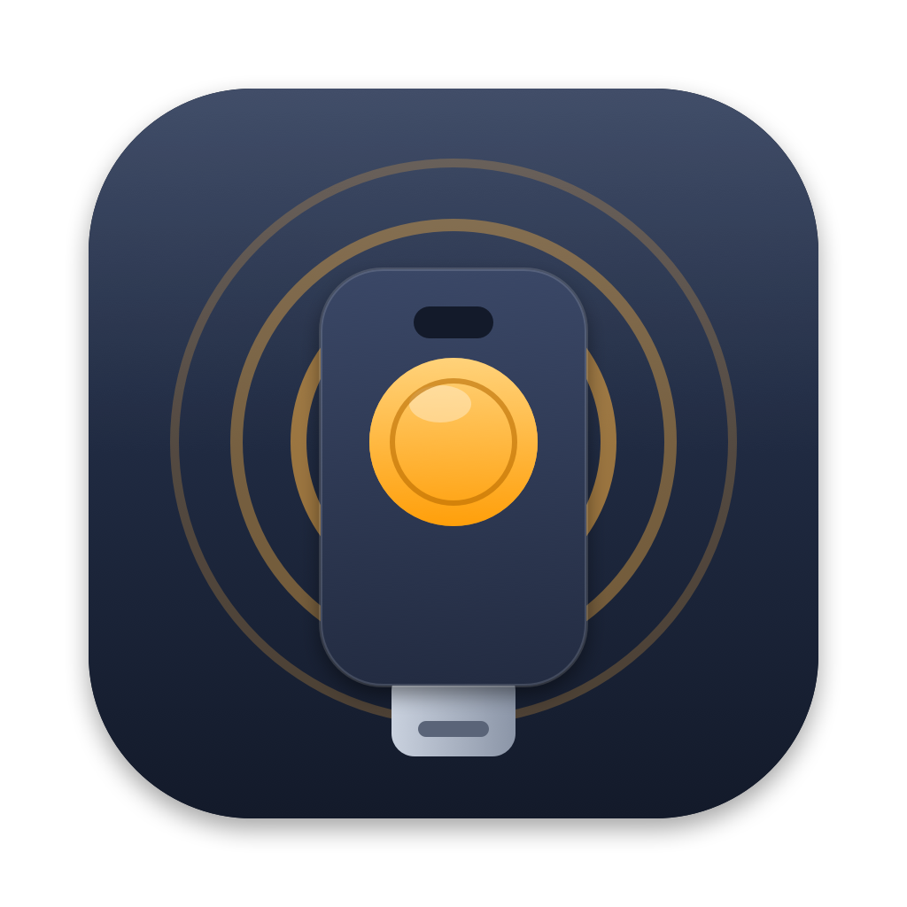
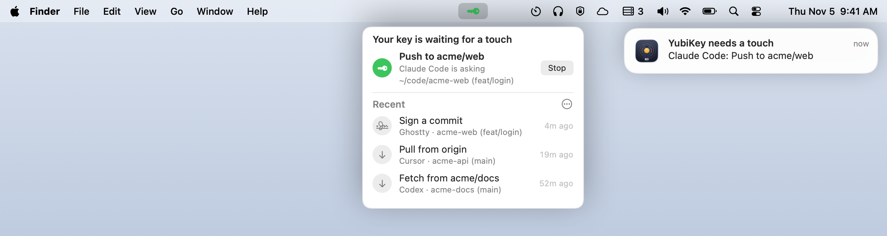

<div align="center">



# Blinker

**Know why your YubiKey is blinking.**

When your key waits for a touch, Blinker tells you who asked and what for, before the
request times out.

[](https://github.com/guneysol/blinker/actions/workflows/build.yml)


[](LICENSE)

<picture>
  <source media="(prefers-color-scheme: dark)" srcset="docs/demo-dark.png">
  
</picture>

</div>

## Install

```bash
curl -fsSL https://raw.githubusercontent.com/guneysol/blinker/main/install.sh | bash
```

This builds from source in under a minute and installs **Blinker.app** to your Applications
folder, where you can open it like any other app. Look for the key icon in your menu bar, allow
notifications when macOS asks, then turn on **Launch at Login** from the `⋯` menu.

**What the installer does:**

1. It checks for Apple's developer tools.
2. It clones the latest release tag into a temporary folder, which it deletes afterwards.
3. It builds Blinker and copies it to `/Applications`, or to `~/Applications` if your account
   can't write to `/Applications` without sudo.

It needs no sudo and touches nothing else. [Read the script](install.sh).

<details>
<summary><b>Prefer to look first?</b></summary>

Download the script, read it, then run it:

```bash
curl -fsSLo install.sh https://raw.githubusercontent.com/guneysol/blinker/main/install.sh
less install.sh
bash install.sh
```

Or skip the script and build it yourself:

```bash
git clone https://github.com/guneysol/blinker && cd blinker
tag=$(git describe --tags --abbrev=0) && git checkout -q "$tag"   # the latest release
git tag -v "$tag"   # optional: check that release's signature
./build.sh --install
```
</details>

**Requires** macOS 14 or later, Apple's developer tools, and an **admin account**. macOS only
lets admin accounts read the system log, which Blinker watches.

## Why

Your key signs commits and authenticates `git push`, but it has no screen. It blinks, and the
request times out after about 15 seconds if you don't notice. Then whatever asked fails or hangs.
With AI agents running git in the background, you often don't know a request is waiting. When
you do notice, you don't know what you'd be approving.

YubiKeys have no setting for this. The key can't tell your Mac why it's waiting, and the computer
gets no "waiting for touch" event. Blinker reads that state from macOS itself and matches it to
the program that asked.

## What it does

- **Notices the wait.** You get a notification within about half a second of the key starting
  to blink, and the menu bar key blinks green. Both go away when you touch the key.
- **Says who asked and why.** For example "Claude Code wants to push to org/repo on github.com",
  "Ghostty wants to sign a commit" or "Codex wants to fetch from org/repo", with the folder and
  branch it runs in. It recognizes Claude Code, Codex, Gemini CLI, Cursor, Aider, opencode and
  more, plus the terminal or editor you started it from.
- **Flags anything odd.** Blinker warns, or lists every candidate, instead of guessing:
  - Several programs asked at once (it names them all), or nothing it can see did.
  - The program runs from an unusual place, like `/tmp`, or its name doesn't match its file.
  - The SSH connection goes somewhere other than the host shown, or forwards your key.
- **Lets you stop it.** The notification and the menu have a **Stop** button that cancels the
  waiting request. Use it on a stuck `git fetch` or something you didn't start.
- **Keeps a short history.** The menu lists the last 20 requests and when each happened. The
  history lives in memory only and is gone when you quit.
- **Stays light.** Idle, it uses 0% CPU and causes no wakeups; its log helper takes about 5 MB,
  and macOS filters the log before anything reaches Blinker. When your key starts waiting, it
  reads process data straight from the kernel (no `ps` or `lsof`) in about 6 ms.

## How it works

1. **Detecting the wait.** While a smart-card key waits for a touch, it keeps asking the USB
   reader for more time, about every 290 ms. Apple's smart-card driver logs each request.
   Blinker streams only those log lines, filtered inside macOS before they reach Blinker. It
   accepts them only from Apple's own driver, which lives under SIP-protected `/System`, so
   another program can't fake one. Touching the key stops the requests.
2. **Finding who asked.** Your key only waits on behalf of a program connected to the agent that
   holds it (`gpg-agent`, `ssh-agent` or `yubikey-agent`), and that program is blocked until you
   touch. Blinker lists the programs connected to the agent's socket right then. It describes
   each one from its executable, its arguments, the programs that started it, and its folder and
   git branch.

This works with OpenPGP and PIV keys used through gpg-agent, ssh-agent or yubikey-agent. That
covers `git commit -S`, `git push` over SSH, and `ssh`, whenever your key's **touch policy** (its
setting for whether an operation needs a touch; see `ykman openpgp info`) asks for one. FIDO2 keys (`sk-ssh-ed25519`, passkeys)
work differently and aren't detected yet. See the [FAQ](#faq).

## Security and privacy

Blinker shows two things, and they deserve different levels of trust:

- **"Your key is waiting" is reliable.** It comes from Apple's smart-card driver, and other
  programs can't fake it.
- **Who asked and why is a best guess.** It's read from the names, arguments and folders of the
  programs connected to your key's agent. Any program running as you can set all of those.
  Blinker warns when something looks off, but it can't prove who asked.

**Treat a Blinker notification as a reminder to check, never as permission to touch.** If you
didn't just start the action it describes, don't touch your key.

What Blinker does and doesn't do:

- It makes **no network connections** and sends nothing anywhere.
- It runs as you. It never asks for sudo, and it can only stop your own processes.
- It saves two settings: notifications and sound. Request history stays in memory until you quit.
- Notifications show only who asked and what for ("Claude Code: Push to acme/web"), never the
  command, because macOS keeps delivered notifications on disk. Commands shown in the menu have
  tokens and passwords removed, as far as the app can tell.
- It reads other programs' arguments, never their environment variables, and never looks inside
  Desktop, Documents, Downloads, iCloud Drive or network drives, so it doesn't trigger privacy
  prompts.
- It's built from source on your Mac, with an ad-hoc signature and the hardened runtime. It isn't
  notarized by Apple.

To report a vulnerability, see [SECURITY.md](SECURITY.md).

## FAQ

<details>
<summary><b>Can't I just make my key ask less?</b></summary>

Yes, and that pairs well with Blinker. With the `cached` touch policy, one touch covers 15 seconds
of requests, so a push that authenticates twice needs only one touch:

```bash
ykman openpgp keys set-touch aut cached   # for SSH; use "sig" for signing
```

Check your current policies with `ykman openpgp info`.
</details>

<details>
<summary><b>It listed two programs, "one of these is asking".</b></summary>

Two programs asked your key's agent at the same moment, for example two pushes. Your touch goes to
whichever one the agent is serving first, and that can't be seen from outside, so Blinker names
both instead of guessing. Click the notification to open the menu, where each has a Stop button.
If it says no program it can see is asking, don't touch unless you started something. A connection older than a minute is listed as idle (often a
stuck `git fetch`), and you can stop it there.
</details>

<details>
<summary><b>Why does it need an admin account?</b></summary>

The wait is only visible in the system log, and macOS only lets admin accounts (or members of the
`_developer` group) stream it. Blinker doesn't need sudo: it just runs `/usr/bin/log stream` as
you.
</details>

<details>
<summary><b>What about FIDO2 / security-key SSH keys?</b></summary>

Those talk to the key over a different USB channel and don't produce the log lines Blinker
watches. Support is planned.
</details>

<details>
<summary><b>Why is there no downloadable app or Homebrew cask?</b></summary>

A downloaded app has to be notarized by Apple, or Gatekeeper blocks it. Building from source
avoids that, and the whole app is about 1,900 lines of Swift, easy to read before you run it.
</details>

## Update and uninstall

To update, run the install command again. Follow [@guneysol](https://x.com/guneysol) to hear about
new releases.

To uninstall, turn off **Launch at Login** in the `⋯` menu, quit Blinker, then:

```bash
rm -rf /Applications/Blinker.app ~/Applications/Blinker.app
defaults delete io.github.guneysol.blinker 2>/dev/null
```

macOS keeps Blinker's entry in System Settings › Notifications for a while; you can remove it
there, or it goes away on its own.

## Contributing

Feedback and ideas are welcome: DM [@guneysol](https://x.com/guneysol) on X, or use **Send
Feedback on X** in the app's `⋯` menu. Bug reports, agent names and PRs are welcome too.
[`CONTRIBUTING.md`](CONTRIBUTING.md) covers the development loop and the debug commands.

## License

[MIT](LICENSE)

---

<div align="center">

Made by [@guneysol](https://x.com/guneysol). Follow for updates.

</div>
